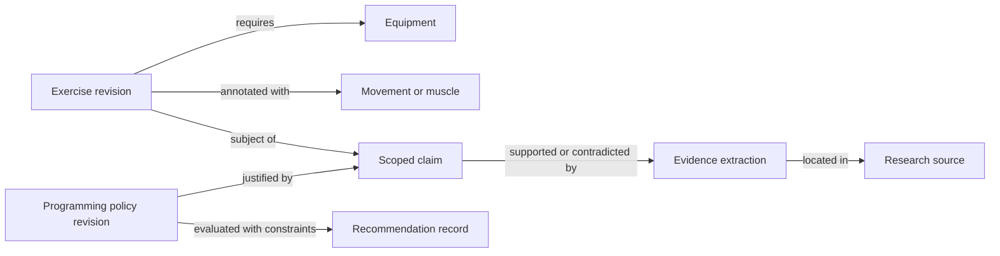

# Constructing and persisting the exercise corpus and graph

Research date: 2026-10-18. Status: proposed POC design; no application, database,
or recommendation engine has been implemented.

## Recommendation

Start with approximately 50 manually curated resistance-training exercise variants
and store a typed graph in PostgreSQL. Keep reviewable seed records in versioned
JSON files and derive candidate relationships from explicit movement, equipment,
and muscle annotations. Attach research evidence to claims and programming rules,
with context and review status. Require coach review of proposed programmes.

The initial size is an engineering scope choice, not a scientifically optimal
number. Assume a POC for generally healthy adults doing general strength training.
This assumption narrows research and evaluation; it is not a claim that every
exercise or policy is suitable for every adult.

The first useful demonstration should answer: “Given available equipment, the
coach's desired movement coverage, and explicit client constraints, which reviewed
exercises could fill this programme slot, and why?” Defer individualized kilogram
recommendations until reliable exercise-specific performance records and reviewed
progression policies exist.

## Research coverage and limitations

Technical findings below were checked against upstream repository content,
including an actual exercise dataset, on the research date. The source list records
the inspected revisions. PostgreSQL findings were checked in its official source
documentation; no database benchmark was run.

Scientific article retrieval was attempted through Europe PMC, PubMed, PMC, and
Crossref. All were blocked by the environment's network proxy with HTTP 403.
The scientific references below are a **candidate reading list**, not an inspected
body of evidence. Their metadata, findings, applicability, and current status still
need verification. This document is a technical construction proposal and a
literature-review protocol, not a completed scientific review.

Access additions for `www.ebi.ac.uk`, `pubmed.ncbi.nlm.nih.gov`,
`pmc.ncbi.nlm.nih.gov`, and `api.crossref.org` were saved to the environment draft.
They require review/save and publication in environment settings; a retry after
the draft save was still blocked. No new runtime access is assumed.

## What scientific grounding requires

Separate five kinds of information rather than treating every graph edge as a
scientifically established fact:

| Information | Example | Appropriate basis |
| --- | --- | --- |
| Exercise identity and execution | Dumbbell goblet squat, bilateral, prescribed range of motion | Precise definition, reviewed description, provenance |
| Anatomical/biomechanical annotation | A muscle has a specified role during that defined variant | Relevant anatomy/biomechanics reference and reviewer rationale |
| Training-outcome claim | An intervention changed a measured strength outcome in a studied population | Applicable research, extracted result, uncertainty and limitations |
| Programming policy | A progression or exercise-selection rule for a particular goal | Reviewed evidence plus explicitly identified coaching judgments |
| Client observation | Load, repetitions, reported exertion, or discomfort in a particular set | Timestamped session record; not causal evidence by itself |

For each research claim, record population, training experience, intervention,
comparator, outcome and measurement method, duration, source locator, extracted
result, limitations, and the reviewer’s applicability judgment. Keep acute and
longitudinal outcomes distinct. An exercise appearing in a study does not validate
all of its catalog annotations or all possible uses.

Record source review depth (`metadata_only`, `abstract_only`, `full_text`) separately
from claim disposition (`unreviewed`, `accepted`, `disputed`, `rejected`, `superseded`).
Acceptance means reviewed for the stated use, not universally true. Capture
supporting, contradicting, and indirect evidence. Store a reasoned certainty
assessment; do not derive an arbitrary percentage from study count or citation count.

Do not infer training superiority, precise muscle stimulus percentages, or injury
probabilities from shared tags or an acute EMG ranking. Do not treat absence of a
reported contraindication as proof of suitability. Where evidence is missing,
retain “unknown” or identify a coach heuristic rather than manufacturing support.

### Candidate scientific reading list — verification pending

These are starting points for review, not approved prescribing policies. Dates
and identifiers below must be checked against the article records before import.
Older guidance must be checked for superseding guidance as of the review date.

| Candidate source | Question to investigate before using it |
| --- | --- |
| ACSM (2009), *Progression Models in Resistance Training for Healthy Adults*, [DOI 10.1249/MSS.0b013e3181915670](https://doi.org/10.1249/MSS.0b013e3181915670), [PubMed](https://pubmed.ncbi.nlm.nih.gov/19204579/) | How are progression recommendations scoped to goal and training status? What newer guidance supersedes this historical position stand? |
| Currier et al. (2023), *Resistance training prescription for muscle strength and hypertrophy in healthy adults: a systematic review and Bayesian network meta-analysis*, [DOI 10.1136/bjsports-2023-106807](https://doi.org/10.1136/bjsports-2023-106807) | How do load, sets, and frequency relate to distinct outcomes? What uncertainty, study limitations, and population coverage limit individual inference? |
| Schoenfeld, Ogborn and Krieger (2017), *Dose-response relationship between weekly resistance training volume and increases in muscle mass: a systematic review and meta-analysis*, [DOI 10.1080/02640414.2016.1210197](https://doi.org/10.1080/02640414.2016.1210197) | How was volume defined, and what limits applying aggregate results to a particular person, muscle, or circuit? |
| Zourdos et al. (2016), *Novel Resistance Training-Specific Rating of Perceived Exertion Scale With Repetitions in Reserve*, [DOI 10.1519/JSC.0000000000001049](https://doi.org/10.1519/JSC.0000000000001049) | In whom and under which exercises/conditions was RIR-based exertion assessed? How reliable is it for the intended users? |
| Vigotsky et al. (2018), *Interpreting Signal Amplitudes in Surface Electromyography Studies in Sport and Rehabilitation Sciences*, [DOI 10.3389/fphys.2017.00985](https://doi.org/10.3389/fphys.2017.00985) | Which inferences can an acute EMG study support, and which long-term adaptations require other evidence? |

No numerical set, repetition, load, or progression rule in this proposal is
claimed to have been validated by these unread sources.

### Literature-review procedure

Once access works, search PubMed/Europe PMC with recorded query strings and search
dates. Start with `resistance training AND (strength OR hypertrophy) AND (systematic
review OR meta-analysis)`; add focused searches for exercise selection/substitution,
range of motion, exercise order, rest intervals, volume, load, autoregulation, and
RIR/RPE. These are proposed searches and have not yet been executed successfully.

Use generally healthy adults as the initial population; record age, sex, experience,
training duration, and outcome specificity. Separate rehabilitation, pediatric,
pregnancy, and disease-specific evidence from this initial scope. Follow citations
and newer citing reviews, and include relevant professional guidance. Record
inclusion/exclusion reasons and overlapping primary trials to avoid counting the
same evidence several times.

Check DOI/title/year, corrections, retractions, and superseding publications.
Extract passages/tables from legally accessible full text where available; mark
abstract-only assessments and their limits. Have a second reviewer check claims
used by enabled recommendation policies. Publish a small reviewed evidence table
before enabling any such policy. This is a focused POC review, not a claim to a
registered or exhaustive systematic review.

## Candidate corpus sources

| Source | Verified observations | Proposed use |
| --- | --- | --- |
| [Free Exercise DB][dataset] | Downloaded JSON contains 876 entries and descriptive fields, but no structured study citations or review-status fields. README describes public-domain/Unlicense licensing and derivation from another dataset. | A source of candidate names, aliases, and descriptions for curation. Do not equate catalog inclusion with scientific validation. |
| [wger][wger] | README describes an exercise wiki/API. Code is AGPL-3.0-or-later; data uses per-entry Creative Commons licences. The inspected image model has a separate licensing base and the licence model records licence identity/URL. | Useful reference for exercise/media provenance and data structures. Inspect each actual entry and its media rights before reuse; no live API import was tested. |
| Manually authored seed corpus | No external import dependency, but still requires references and expert review. | Recommended first release: select representative variants, author concise descriptions, and cite sources for accepted annotations. |

### Dataset audit

Free Exercise DB revision: `f00c92c7dcf1216a928a52c3706c7ce8e2f71ed5`.
Downloaded `dist/exercises.json` SHA-256:
`5bb747e3fc658f095a60dcbf6d53c96627acdcc6ffb6fffde86f7e26995d40bf`.

- 876 records; all 876 `id` values were unique in the downloaded file.
- Missing/null equipment: 77; force: 30; mechanic: 87.
- Categories: strength 584, stretching 123, plyometrics 61, powerlifting 38,
  Olympic weightlifting 35, strongman 21, cardio 14.
- Fields: `id`, `name`, `force`, `level`, `mechanic`, `equipment`, `primaryMuscles`,
  `secondaryMuscles`, `instructions`, `category`, `images`.

These results demonstrate catalog availability and data-cleaning needs; they do
not validate the annotations. “Body only,” equipment `null`, and an unknown required
item must remain distinct. “Beginner” is an imported label, not an independently
validated suitability assessment. Broad labels such as “chest” and “middle back”
need an explicit mapping to the project's vocabulary.

The repository's public-domain statement is not an independent verification of
upstream rights, particularly for photographs. Preserve source/author/licence
records and review the rights chain. Start without externally sourced media if
that review is unresolved. Data licensing and application-code licensing are
separate decisions; a repository's code licence is not automatically the licence
for every exercise description or image it contains.

## Constructing the POC

1. **Define a controlled vocabulary.** Start with squat/knee-dominant, hinge,
   horizontal/vertical push and pull, single-leg/lunge, trunk, and carry categories.
   Allow multiple annotations, joint actions, and an unknown/unclassified state.
   These are useful coaching categories, not a universally agreed scientific ontology.
2. **Choose approximately 50 variants.** Cover the intended movement categories,
   a few equipment configurations, and bilateral/unilateral examples. Exclude
   specialized populations and complex sports-specific movements from the first
   demonstration. Have a coach review coverage and execution descriptions.
3. **Normalize identity.** Assign project-owned immutable IDs; keep source IDs and
   aliases separately. Distinguish material differences in equipment, support,
   stance, grip, range of motion, assistance, and execution. Do not collapse all
   “squats” into one exercise or imply equivalent loading across variants.
4. **Stage, validate, and curate.** Retain an immutable source snapshot and import
   manifest outside the application’s active catalog. Validate types, units,
   duplicates, vocabulary mappings, required equipment, and licence metadata.
   Resolve uncertain annotations through review; never guess missing values.
5. **Attach evidence at claim level.** Review anatomical descriptions and programming
   claims with the appropriate source types. Store the relevant source passage,
   conditions, and reviewer decision. Unreviewed claims are ineligible for use in
   recommendations, even if the descriptive exercise record is searchable.
6. **Publish a versioned corpus.** Export accepted records, assertions, source
   metadata, and review decisions with a manifest and checksums. Make imports
   repeatable and produce a report of inserted, unchanged, updated, and rejected rows.

Useful exercise fields include name/aliases; execution definition; movement and
joint actions; muscle roles; required equipment including bench/rack/support;
laterality; stability/support; range-of-motion definition; instructions; loading
convention; source/licence; and review state. Keep knowledge claims versioned
instead of treating these fields as unquestionable facts.

Loading conventions need explicit units and semantics: total barbell load,
per-dumbbell load, machine setting/device identity, added bodyweight load,
assistance, or non-load measures such as duration/distance. A bodyweight movement
is not necessarily a zero-load exercise; machine-stack numbers are not universally
comparable. Log left/right work separately when needed.

## Graph semantics

Use relationships with narrow meanings and explicit context:

| Relationship | Meaning and limits |
| --- | --- |
| `VARIANT_OF` | A defined execution variant belongs to an exercise family; does not imply equal load or outcome. |
| `REQUIRES_EQUIPMENT` | The execution requires this item; support items also count. |
| `HAS_MOVEMENT_PATTERN` / `HAS_JOINT_ACTION` | Reviewed descriptive annotation under the chosen vocabulary. |
| `INVOLVES_MUSCLE` | Qualitative role under a defined execution; not a numeric hypertrophy score. |
| `SUBSTITUTION_CANDIDATE` | Potential replacement under named equipment, goal, and client constraints; directed and reviewed where persisted. |
| `SUPPORTED_BY` / `CONTRADICTED_BY` | Links a scoped claim to an extracted evidence record, with directness and rationale. |

Derive substitution candidates from shared reviewed attributes; check their
constraints before presenting them. Do not infer transitive equivalence: A being a
candidate for B and B for C does not establish A for C. Do not transfer estimated
working weights across exercises just because a graph path connects them.

“Complementary” or “contrarian” is underspecified in the original requirements.
For the POC, interpret it as coach-selected movement coverage and manageable
within-session demands. Define the target explicitly before scoring. An
antagonist muscle relationship does not by itself prove that a particular circuit
improves outcomes. Persist contextual coach-approved pairings separately from
research claims and regenerate computed pairings when their inputs change.

The diagram is a logical model. Edges involving claims carry their own review and
provenance metadata; they are not automatically approved by adding a citation.

## Persistence options

| Option | Strengths | Tradeoffs | POC judgment |
| --- | --- | --- | --- |
| Versioned JSON only | Easy to review, diff, export, and reproduce | Application must implement integrity, concurrent editing, and querying | Use for seeds/exchanges, not the only multi-user store |
| SQLite with typed relations | Small local prototype, one file, relational queries | Concurrent writer and hosted deployment constraints need consideration | Reasonable for a strictly local, single-user prototype |
| PostgreSQL with typed relations | Foreign keys, transactions, recursive CTEs, JSONB, and row-security capabilities verified in official docs | Requires a database service; graph queries need explicit joins/CTEs | Recommended for the coach/client product direction |
| Native property graph such as Neo4j | Graph-oriented modeling and traversal could suit relationship-heavy exploration | Another datastore/skill set; edition, licence, deployment, and performance need evaluation | Reconsider if measured query requirements justify it; not independently evaluated here |
| RDF/triple store | Could help if formal ontologies and external semantic interchange become core requirements | Ontology, provenance, querying, and operational complexity | Defer; not independently evaluated here |

PostgreSQL is a design recommendation, not a benchmark conclusion. The expected
POC operations are filtering and short traversals alongside transactional programme
and session data. A graph does not require a dedicated graph database. Revisit
the choice if measured workloads require frequent deep/path-heavy traversals,
external graph interoperability, or operations PostgreSQL cannot meet adequately.

### Proposed PostgreSQL logical schema

This is a schema sketch, not executed migration SQL.

| Tables | Responsibility |
| --- | --- |
| `exercise`, `exercise_revision`, `exercise_alias` | Stable identity, immutable execution versions, source aliases |
| `muscle`, `movement_pattern`, `joint_action`, `equipment` | Controlled vocabulary with versioned definitions where needed |
| `exercise_muscle`, `exercise_pattern`, `exercise_joint_action`, `exercise_equipment` | Typed annotations referencing exercise revisions and their review/claim records |
| `exercise_relation` | Directed variant/candidate relationships with endpoints, kind, context, review state, and provenance |
| `source`, `source_version`, `import_batch`, `media_asset` | DOI/URL/licence/author metadata, retrieval details, checksums, item-level media rights |
| `claim`, `claim_subject`, `evidence_extraction`, `claim_evidence`, `review` | Scoped assertions, exact source locators, supporting/contradicting evidence, reviewer decisions |
| `programming_policy_revision`, `recommendation` | Versioned rules and a record of constraints, inputs, corpus version, output, rationale, and override |

For `claim_subject`, use explicit foreign keys to supported subject types
(exercise revision, anatomical entity, or policy) and a constraint requiring
exactly one typed target per row. Permit multiple subjects per claim. Avoid a
free-form `target_type`/`target_id` pair with no referential integrity.

Keep core identities, types, and relationships normalized. Use JSONB for scoped
qualifiers and preserved source payloads, with application schema validation;
JSONB alone does not enforce a domain schema. Do not store the entire graph as
one unvalidated JSON document. Use foreign keys, uniqueness, and check constraints
for valid endpoints, units, and ranges; enforce allowed endpoint types and variant
cycle rules in the write path and integrity checks. Foreign keys alone do not
enforce graph semantics.

Index common filters and both traversal directions: annotation subject/object IDs,
relationship endpoints/kind, review status, and external source identity. Use
recursive CTEs for bounded family traversal, with depth limits and cycle handling.
An ordinary join is sufficient for direct equipment or muscle filtering. Introduce
derived/materialized views only after measuring the actual queries.

Later, add coach/client authorization, programme templates and versions,
per-client session prescriptions, and actual set records in separate tables. A
shared programme template must not overwrite client-specific target or actual
loads. Capture timestamps, exercise revision, load convention, repetitions, and
optional RIR/RPE with its scale definition. Treat reported energy as an observation,
not a scientifically calibrated load multiplier. Public corpus exports must
exclude identifiable client records.

Use migrations, transactions, repeatable seed upserts, and immutable accepted
revisions. New source imports should propose changes rather than silently
overwriting reviewed records. Pin recommendation records to the exact corpus and
rule versions. Keep licensed text/media in appropriate storage with attribution;
do not copy full copyrighted papers merely to retain an evidence locator.
Backups need a demonstrated restore procedure, not just a successful export.

## Recommendation behaviour for the POC

1. Apply hard constraints first: enabled review status, known required equipment,
   requested movement coverage, defined client restrictions, and policy applicability.
2. Retrieve eligible candidates through reviewed annotations and explicit relations.
3. Rank using explainable coach-selected preferences such as coverage, equipment
   transitions, and recorded client familiarity. Label weights and tie-breakers as
   product/coach heuristics until evaluated; do not call a ranking score “scientific confidence.”
4. Return exercise IDs/revisions, matched constraints, remaining uncertainty, rule
   versions, and evidence links. Return “no suitable reviewed candidate” when needed.
5. Let the coach accept or override; retain the reason and the original proposal.

Keep set/rep and progression policies separate from catalog similarity. Do not
generate precise loads from demographics or a “low energy” flag in the corpus POC.
Future load proposals require comparable exercise-specific records, explicit
rounding/equipment increments, validated policy scope, and coach review. No such
policy is enabled or scientifically validated by this document.

## POC evaluation and next deliverables

Before implementation, convert this proposal into a scoped plan after the intended
population and first coach workflow are settled. A useful first release would include:

- Approximately 50 curated exercise variants with IDs, execution definitions,
  equipment, loading conventions, source/licence records, and review decisions.
- A small evidence table covering the claims actually used; remaining questions
  stay explicit. Scientific retrieval/review is a prerequisite for enabling
  research-based recommendation policies.
- A schema/migration and deterministic import/export pipeline that rejects unknown
  vocabulary, orphan relationships, duplicate identities, invalid units, and
  recommendation-enabling claims without the required review.
- A coach-reviewed fixture set, for example 10 scenarios covering missing equipment,
  an unknown annotation, a substitution with different loading semantics, a disputed
  claim, an inapplicable policy, and no eligible candidates. The scenario count is a
  scope choice; expected candidate inclusion/exclusion matters more than the count.
- Demonstrated import repeatability, bounded traversal/cycle handling, version-pinned
  explanations, and database backup restoration. Later client features require
  authorization/isolation checks before using real client records.

Measure constraint violations, explanation completeness, reviewer disagreement,
and coach acceptance of candidate sets. These evaluate the software/workflow;
they do not establish improvements in strength, hypertrophy, or injury outcomes.
Those claims would need appropriate prospective evaluation.

## Inspected technical sources

All were retrieved on 2026-10-18 through their official GitHub repositories. Files
initially read on branch URLs were fetched again at these pinned commits and
verified byte-for-byte identical. Third-party exercise data was inspected in
temporary research storage, not imported into this repository or an application.

1. [Free Exercise DB README][dataset], [schema][dataset-schema], and
   [downloaded catalog][dataset-json], revision
   `f00c92c7dcf1216a928a52c3706c7ce8e2f71ed5`.
2. [wger README][wger], [image model][wger-image], and [licence model][wger-license],
   revision `8f72cb2feba9f5f1cc40aa9855b185ab315a3cd8`.
3. PostgreSQL 17 official source documentation: [recursive queries][pg-queries],
   [JSON/JSONB][pg-json], and [constraints/row security][pg-ddl], revision
   `65e944d92b082cc16e2265a91bab8b73934a0e74`.

[dataset]: https://github.com/yuhonas/free-exercise-db/blob/f00c92c7dcf1216a928a52c3706c7ce8e2f71ed5/README.md
[dataset-schema]: https://github.com/yuhonas/free-exercise-db/blob/f00c92c7dcf1216a928a52c3706c7ce8e2f71ed5/schema.json
[dataset-json]: https://github.com/yuhonas/free-exercise-db/blob/f00c92c7dcf1216a928a52c3706c7ce8e2f71ed5/dist/exercises.json
[wger]: https://github.com/wger-project/wger/blob/8f72cb2feba9f5f1cc40aa9855b185ab315a3cd8/README.md
[wger-image]: https://github.com/wger-project/wger/blob/8f72cb2feba9f5f1cc40aa9855b185ab315a3cd8/wger/exercises/models/image.py
[wger-license]: https://github.com/wger-project/wger/blob/8f72cb2feba9f5f1cc40aa9855b185ab315a3cd8/wger/core/models/license.py
[pg-queries]: https://github.com/postgres/postgres/blob/65e944d92b082cc16e2265a91bab8b73934a0e74/doc/src/sgml/queries.sgml
[pg-json]: https://github.com/postgres/postgres/blob/65e944d92b082cc16e2265a91bab8b73934a0e74/doc/src/sgml/json.sgml
[pg-ddl]: https://github.com/postgres/postgres/blob/65e944d92b082cc16e2265a91bab8b73934a0e74/doc/src/sgml/ddl.sgml
